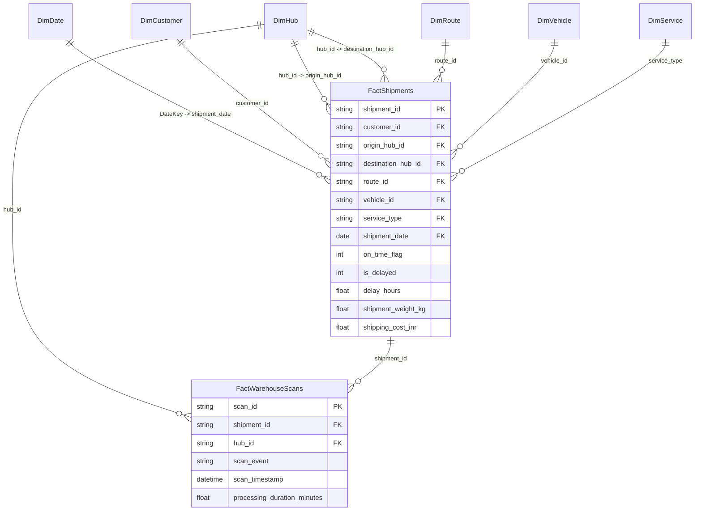

# Power BI Star Schema Model & DAX Business Intelligence Guide
## Kolkata Freight & Logistics Performance Intelligence

> **Classification:** Business Intelligence Engineering Architecture  
> **Target Tool:** Microsoft Power BI / Fabric / Analysis Services  
> **Data Model:** Star Schema with Conformed Dimensions

---

## 1. Star Schema Architecture



---

## 2. Table Relationships & Cardinality

| From Table (Dimension) | From Column | To Table (Fact) | To Column | Cardinality | Cross-Filter Direction | Active |
| :--- | :--- | :--- | :--- | :--- | :--- | :--- |
| `DimDate` | `DateKey` | `FactShipments` | `shipment_date` | 1 to Many ($1:N$) | Single | Yes |
| `DimHub` | `hub_id` | `FactShipments` | `origin_hub_id` | 1 to Many ($1:N$) | Single | Yes |
| `DimHub` | `hub_id` | `FactShipments` | `destination_hub_id` | 1 to Many ($1:N$) | Single | No (USERELATIONSHIP) |
| `DimRoute` | `route_id` | `FactShipments` | `route_id` | 1 to Many ($1:N$) | Single | Yes |
| `DimVehicle` | `vehicle_id` | `FactShipments` | `vehicle_id` | 1 to Many ($1:N$) | Single | Yes |
| `DimCustomer` | `customer_id` | `FactShipments` | `customer_id` | 1 to Many ($1:N$) | Single | Yes |
| `DimService` | `service_type` | `FactShipments` | `service_type` | 1 to Many ($1:N$) | Single | Yes |
| `DimHub` | `hub_id` | `FactWarehouseScans`| `hub_id` | 1 to Many ($1:N$) | Single | Yes |
| `FactShipments` | `shipment_id` | `FactWarehouseScans`| `shipment_id` | 1 to Many ($1:N$) | Single | Yes |

---

## 3. Production DAX Measures

### 3.1 Total Delivered Shipments
```dax
Total Shipments = 
CALCULATE(
    COUNTROWS(FactShipments),
    FactShipments[shipment_status] <> "Lost / Exception"
)
```

### 3.2 On-Time Deliveries
```dax
On-Time Deliveries = 
CALCULATE(
    SUM(FactShipments[on_time_flag]),
    FactShipments[shipment_status] <> "Lost / Exception"
)
```

### 3.3 Delayed Deliveries
```dax
Delayed Deliveries = 
CALCULATE(
    SUM(FactShipments[is_delayed]),
    FactShipments[shipment_status] <> "Lost / Exception"
)
```

### 3.4 On-Time Delivery Rate (OTD %)
```dax
OTD Percentage = 
DIVIDE(
    [On-Time Deliveries],
    [Total Shipments],
    BLANK()
)
```
*Format: Percentage (`0.0%`)*

### 3.5 Previous Quarter OTD Rate
```dax
Previous Quarter OTD = 
CALCULATE(
    [OTD Percentage],
    PREVIOUSQUARTER(DimDate[FullDate])
)
```

### 3.6 OTD Percentage-Point Change (Quarter-over-Quarter)
```dax
OTD Percentage-Point Change = 
IF(
    NOT ISBLANK([Previous Quarter OTD]),
    ([OTD Percentage] - [Previous Quarter OTD]) * 100,
    BLANK()
)
```
*Format: Decimal with Sign (`+0.00; -0.00; 0.00`)*

### 3.7 Average Delivery Delay (Hours)
```dax
Average Delivery Delay = 
AVERAGEX(
    FILTER(FactShipments, FactShipments[is_delayed] = 1),
    FactShipments[delay_hours]
)
```

### 3.8 Total Vehicle Downtime (Hours)
```dax
Total Vehicle Downtime = 
SUM(DimVehicle[downtime_hours])
```

### 3.9 Average Warehouse Processing Dwell Time (Minutes)
```dax
Average Warehouse Processing Dwell = 
AVERAGE(FactWarehouseScans[processing_duration_minutes])
```

---

## 4. Power BI CSV Export Manifest

The following pre-formatted CSV files are exported in `data/power_bi_exports/`:
1. `FactShipments.csv` - 349,467 rows of sanitized deliveries with foreign keys and flags.
2. `FactWarehouseScans.csv` - 1,138,043 rows of sorting and arrival scans.
3. `DimDate.csv` - 365 calendar days of FY2024 with ISO weeks, months, quarters, and season tags.
4. `DimHub.csv` - 12 Kolkata logistics hubs with geocoordinates, capacity, and zones.
5. `DimRoute.csv` - 132 highway corridors with distance and planned transit time.
6. `DimVehicle.csv` - 1,400 commercial fleet assets with maintenance profiles.
7. `DimCustomer.csv` - 3,000 corporate client accounts.
8. `DimService.csv` - Service tiers with SLA commitment descriptions.

